# Plateforme Moodle

## Présentation

Projet académique de plateforme éducative fondée sur Moodle. Les fonctionnalités présentées couvrent la gestion des utilisateurs, des cours, des quiz et de la base de données.

## Technologies

Moodle, PHP, MySQL, HTML, CSS, JavaScript et XAMPP.

## Présentation visuelle du projet

Les captures et diagrammes ci-dessous sont extraits du rapport du projet. Ils illustrent les interfaces et la conception, sans vérifier une instance Moodle en direct. Les adresses visibles dans la liste des utilisateurs et la note du quiz sont masquées dans les copies de publication ; les fichiers sources restent inchangés.

Le logo ci-dessous identifie la plateforme utilisée dans le projet.

### Interface de connexion

Écran commun de connexion. Aucun rôle n’est déduit de cette vue.

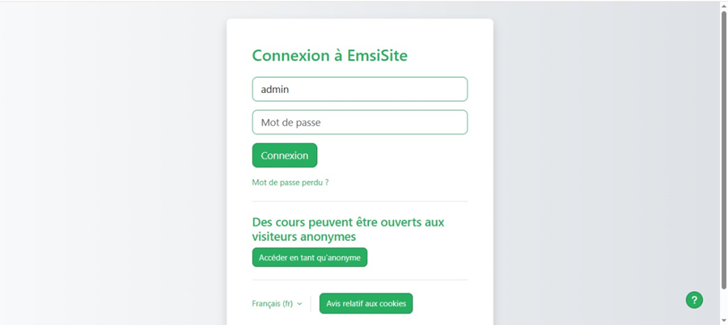

## Interfaces Administrateur

### Tableau de bord

Vue du tableau de bord et de ses éléments de suivi.

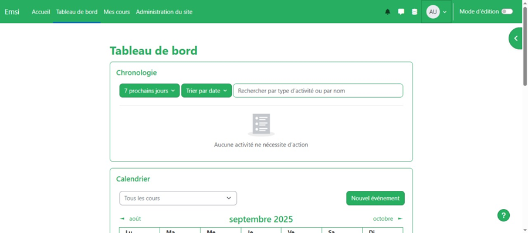

### Gestion des utilisateurs et des rôles

Liste d’utilisateurs de l’administration ; les adresses de courriel sont masquées dans cette copie.

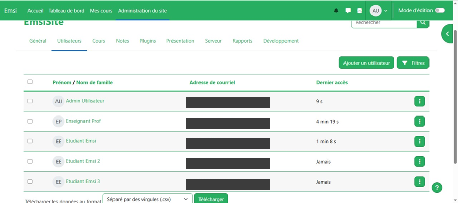

## Interfaces Enseignant

### Vue des cours

Vue d’ensemble des cours associés à l’espace enseignant.

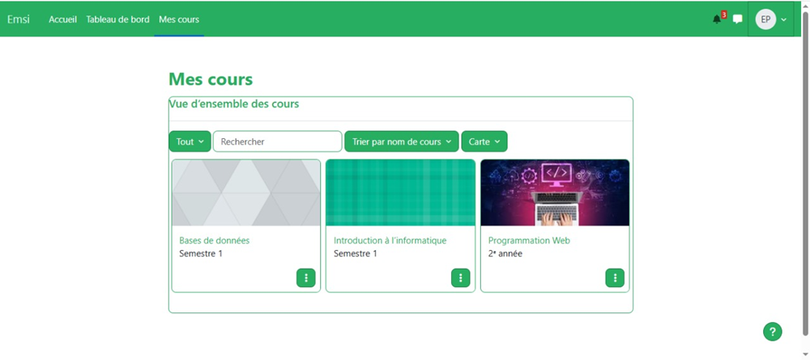

### Tableau de bord

Vue des blocs de chronologie et de calendrier du tableau de bord.

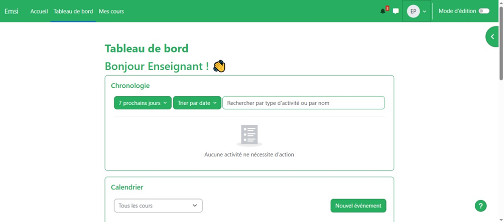

### Contenu du cours Programmation Web

Sections, ressources et activités du cours Programmation Web.

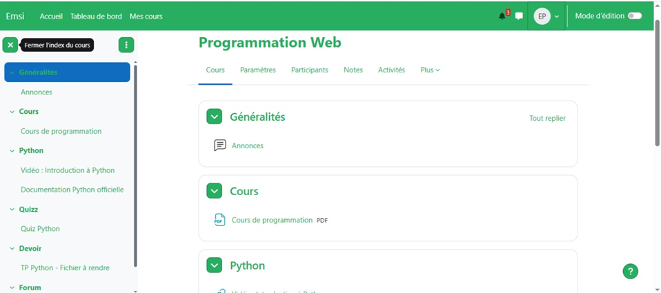

### Gestion des questions du quiz

Liste des questions et options de gestion du quiz.

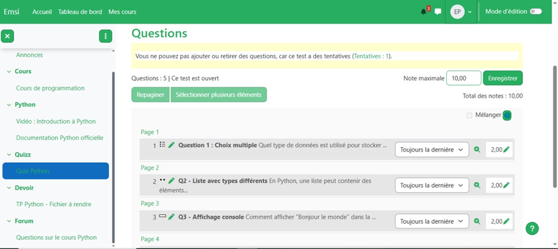

### Gestion d’un devoir

Consignes et paramètres d’un devoir dans l’espace enseignant.

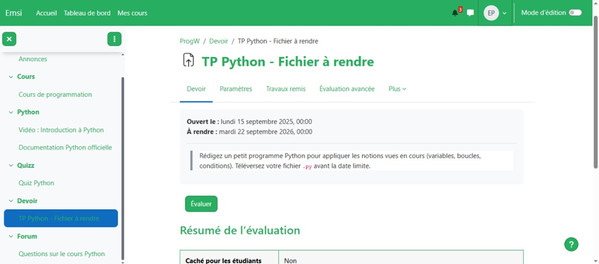

### Forum du cours

Liste des discussions du forum d’un cours.

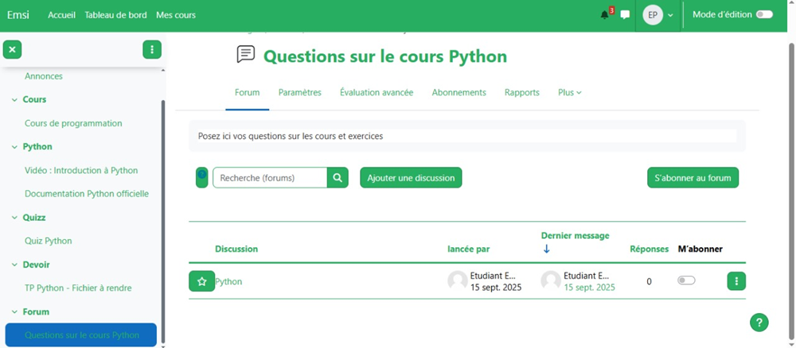

## Interfaces Étudiant

### Tableau de bord

Vue des blocs de chronologie et de calendrier dans l’espace étudiant.

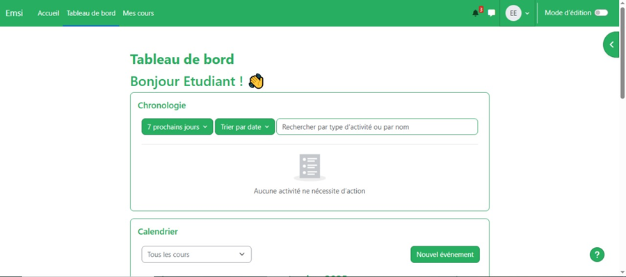

### Vue des cours

Cours présentés sous forme de cartes dans l’espace étudiant.

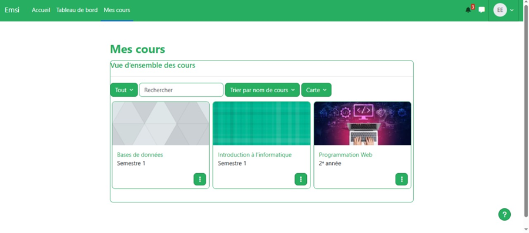

### Résultat du quiz

Consultation d’un quiz et de ses tentatives ; la note est masquée dans cette copie.

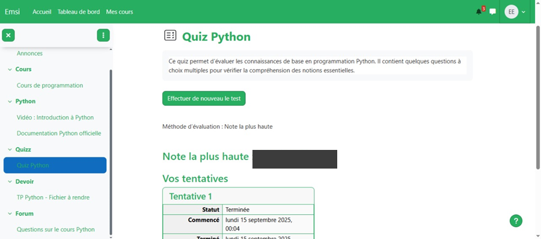

### Devoir à remettre

Consigne du devoir et état de remise visible dans l’interface.

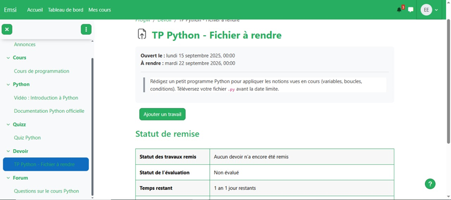

### Forum du cours

Consultation d’une discussion dans le forum du cours.

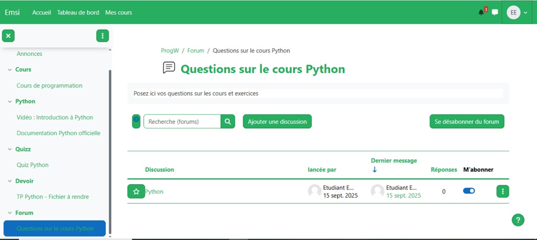

## Conception et diagrammes

### MCD — Modèle conceptuel de données

Représentation conceptuelle des entités du projet et de leurs relations.

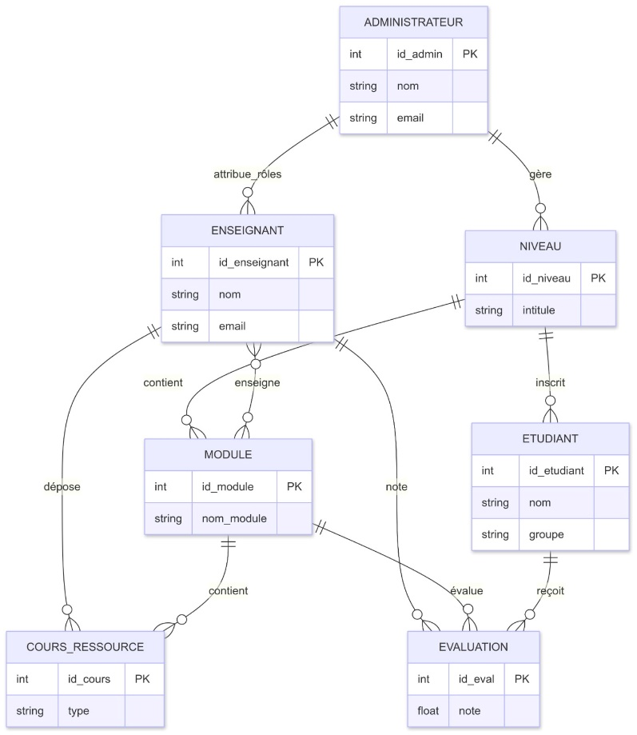

### MLD — Modèle logique de données

Traduction relationnelle du modèle avec les clés primaires et étrangères représentées.

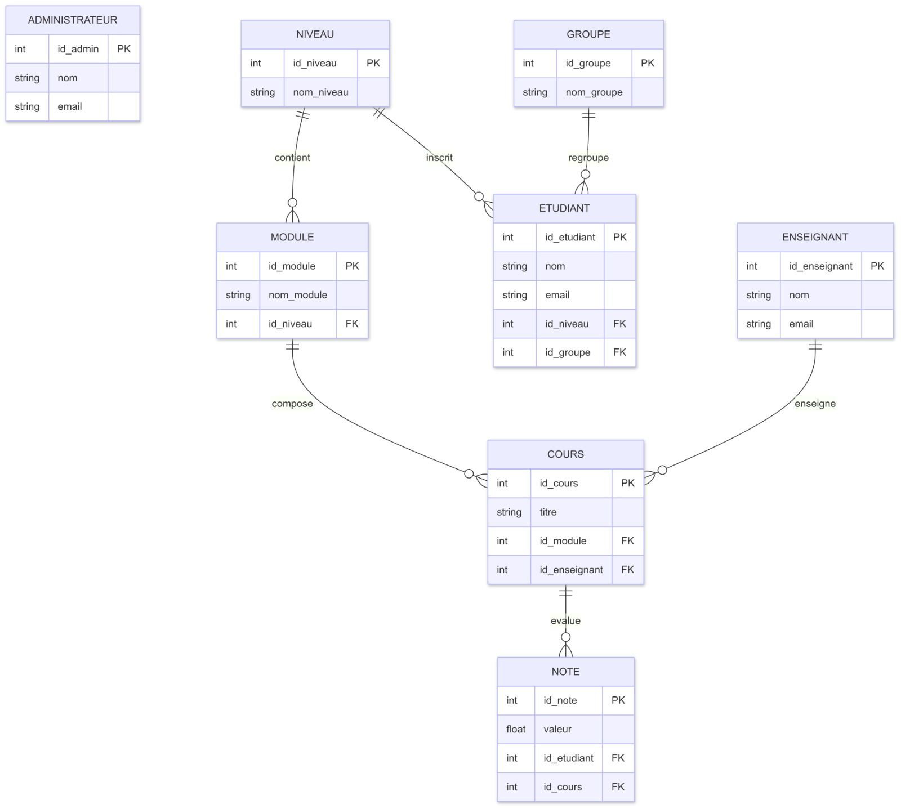

### Organisation des rôles

Résumé des rôles et de leurs principales interactions dans la plateforme.

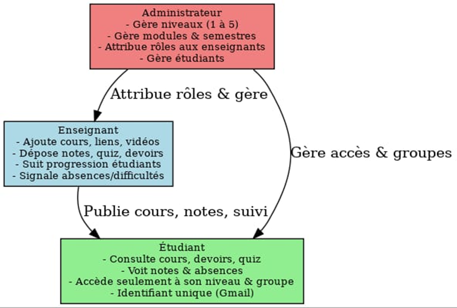

### Diagramme UML de cas d’utilisation

Fonctions principales associées aux rôles administrateur, enseignant et étudiant.

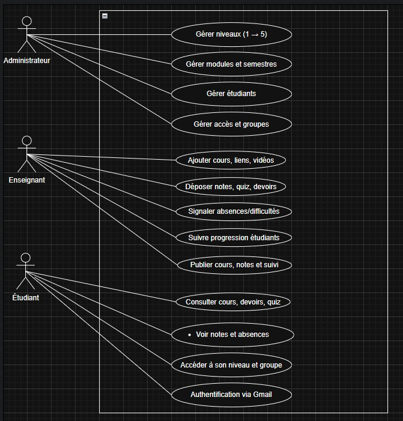

### Diagramme UML de séquence

Échanges entre les rôles et le système pour des opérations pédagogiques.

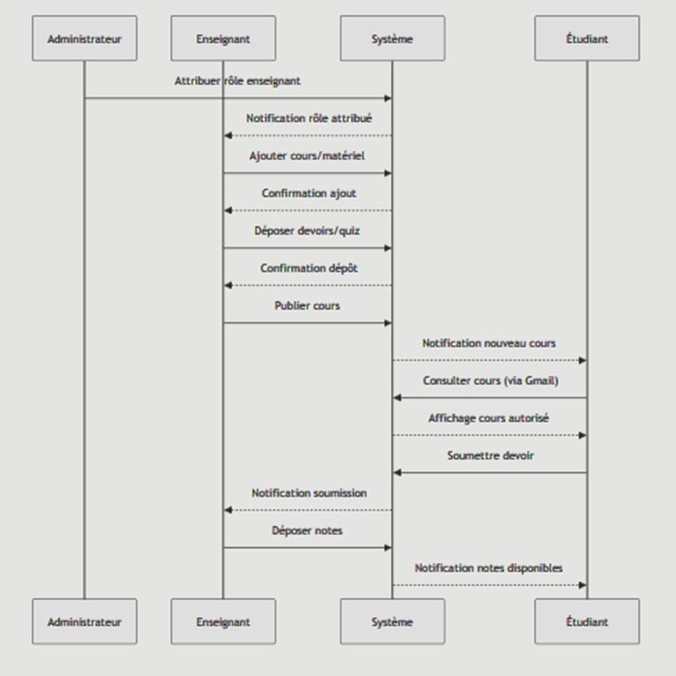

### Diagramme UML de classes

Classes principales et relations représentées dans le modèle.

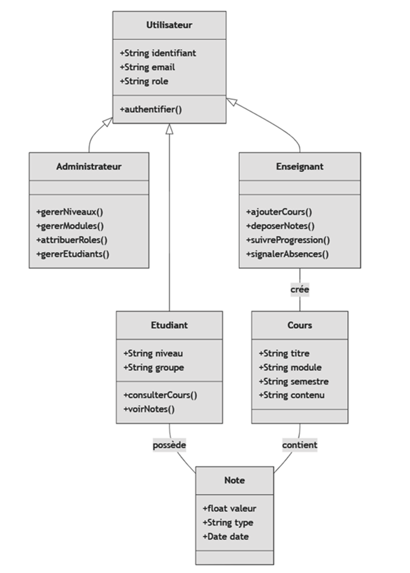

### Diagramme UML d’activité

Enchaînement simplifié des étapes de gestion et de suivi d’un cours.

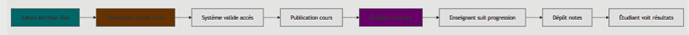

## Cadre

Projet académique. Cette page résume les informations disponibles, ne revendique pas d’expérience professionnelle et n’ajoute pas de fonctionnalités au-delà de celles communiquées.
